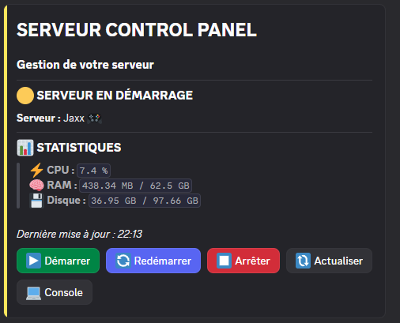

<div align="center">

# 🎮 HebergTonServ Discord Control

### Gérez votre serveur de jeu directement depuis Discord.

**Bot Discord privé conçu principalement pour HebergTonServ.com, basé sur l'API Client WISP.gg et les Discord Components V2.**

[](https://discord.js.org/)
[](https://discord.com/developers/docs/components/overview)
[](https://gamepanel.notion.site/)
[](https://hebergtonserv.com/)
[](https://nodejs.org/)

</div>

> [!IMPORTANT]
> **HebergTonServ.com est la plateforme principalement ciblée et utilisée pour développer ce projet.** Le bot s'appuie sur l'API Client WISP.gg et peut fonctionner avec d'autres panels compatibles. Les différences entre hébergeurs doivent toutefois être vérifiées : la compatibilité universelle n'est pas garantie.

> [!NOTE]
> Ce dépôt présente un **projet indépendant et non officiel**, sauf indication contraire de l'hébergeur. Il n'est pas présenté comme un produit édité ou approuvé par HebergTonServ.com ou WISP.gg.

---

## 📸 Aperçu du dashboard

<div align="center">



*Capture réelle de l'interface Discord. Les métriques et l'état affichés correspondent au moment de la capture.*

</div>

L'interface affiche un **serveur à la fois**, avec ses statistiques et ses actions. Le support **multi-serveurs** reste disponible grâce à la sélection des serveurs configurés. Chaque panneau personnel est **éphémère** : seul son utilisateur peut le voir.

---

## 📚 Sommaire

1. [Fonctionnalités](#-fonctionnalités)
2. [Compatibilité et fonctionnement](#-compatibilité-et-fonctionnement)
3. [Permissions](#-permissions)
4. [Prérequis](#-prérequis)
5. [Installation](#-installation)
6. [Commandes Discord](#-commandes-discord)
7. [Architecture](#-architecture)
8. [Sécurité et comportement des statuts](#-sécurité-et-comportement-des-statuts)
9. [Tests](#-tests)
10. [Dépannage](#-dépannage)
11. [Contribution et licence](#-contribution-et-licence)

---

## ✨ Fonctionnalités

- **Discord Components V2** : containers, séparateurs, boutons, menus de sélection et fenêtres modales, sans embeds classiques pour les interfaces du bot.
- **Dashboard permanent** : panneau dans un salon dédié, avec actualisation périodique configurable et reprise des données persistantes.
- **Dashboard personnel** : `/panel ouvrir` affiche une interface éphémère adaptée aux permissions de l'utilisateur.
- **Gestion multi-serveurs** : sélection d'un serveur WISP configuré, par son nom, sans saisir manuellement son identifiant court.
- **Contrôle d'alimentation** : démarrer, arrêter et redémarrer avec confirmations pour les actions sensibles.
- **Statistiques serveur** : CPU, RAM, disque et autres données lorsque l'API les fournit.
- **Console interactive** : consultation de sorties récentes et envoi de commandes via Discord, selon les capacités de l'API et du WebSocket WISP.
- **Sauvegardes réservées aux Owners** : consultation, création, suppression et restauration selon les autorisations du panel.
- **Journal d'audit** : enregistrement des actions et de leurs résultats dans SQLite, avec notification possible dans un salon Discord dédié.
- **Permissions par rôles** : fonctions de gestion courantes pour le Staff, fonctions sensibles réservées aux Owners.
- **Synchronisation des commandes slash** : publication sur le serveur Discord privé configuré.

**Le gestionnaire de fichiers a été retiré de cette version du projet.** Il ne fait pas partie des fonctionnalités annoncées.

---

## 🌐 Compatibilité et fonctionnement

| Élément | Description |
|---|---|
| Hébergeur ciblé | [HebergTonServ.com](https://hebergtonserv.com/) |
| Panel principal | `https://manage.hebergtonserv.com` |
| API | API Client WISP.gg (`/api/client`) |
| Authentification | Token API Client via `WISP_API_TOKEN` |
| Serveurs | Identifiants courts WISP configurés dans `config/private.json` |
| Interface | Discord.js v14 et Components V2 |
| Persistance | SQLite |

Le lien d'un serveur dans le navigateur ressemble à `https://manage.hebergtonserv.com/server/abcdefgh`. Pour le bot, **l'URL du panel** et **l'identifiant court `abcdefgh`** doivent être configurés séparément.

> [!TIP]
> Le panel Web d'un hébergeur n'est pas une URL d'API. Le bot construit les requêtes à partir de l'URL du panel et des routes Client API WISP.

---

## 🔐 Permissions

| Action | Owner | Rôle autorisé (Staff) |
|---|:---:|:---:|
| Consulter le dashboard et les statistiques | ✅ | ✅ |
| Démarrer / arrêter / redémarrer | ✅ | ✅ |
| Ouvrir et utiliser la console | ✅ | ✅ |
| Sélectionner un serveur configuré | ✅ | ✅ |
| Actualiser le panneau personnel | ✅ | ✅ |
| Forcer l'arrêt (`kill`) | ✅ | ❌ |
| Gérer les sauvegardes | ✅ | ❌ |
| Consulter les logs administratifs | ✅ | ❌ |
| Installer / administrer le dashboard permanent | ✅ | ❌ |
| Diagnostic `/setup` | ✅ | ❌ |

- **Owner** : ID utilisateur figurant dans `DISCORD_OWNER_IDS` (`.env`). Plusieurs IDs peuvent être séparés par des virgules.
- **Staff** : membre possédant au moins un rôle présent dans `discord.allowedRoleIds` (`config/private.json`).
- **Autres utilisateurs** : aucune action de gestion autorisée.

Les autorisations doivent être vérifiées pour chaque commande, bouton, sélection et modal, pas uniquement par l'affichage ou le masquage des boutons.

> [!WARNING]
> **L'accès à la console est puissant.** Même sans gestionnaire de fichiers, certaines commandes de jeu peuvent modifier la configuration du serveur, affecter les joueurs ou disposer de privilèges administratifs. N'attribuez le rôle Staff qu'à des personnes de confiance.

---

## 🧰 Prérequis

- Un environnement **Node.js compatible avec les dépendances du projet**. **Node.js 22 LTS ou plus récent est recommandé** ; vérifiez la contrainte `engines` du `package.json` et la version minimale de Discord.js installée.
- `npm`.
- Un bot Discord créé sur le [Discord Developer Portal](https://discord.com/developers/applications).
- Un serveur Discord dans lequel vous pouvez inviter ce bot.
- Un compte HebergTonServ (ou un panel WISP compatible) et une **clé API Client** disposant des permissions nécessaires.

Vérifiez vos versions :

```bash
node -v
npm -v
```

---

## 🚀 Installation

### 1. Préparer le bot Discord

1. Ouvrez le [Discord Developer Portal](https://discord.com/developers/applications).
2. Créez une application et ouvrez son onglet **Bot**.
3. Générez le token du bot et conservez-le **hors de GitHub**.
4. Dans **OAuth2 > URL Generator**, utilisez les scopes `bot` et `applications.commands`.
5. Invitez le bot sur le serveur Discord souhaité avec les permissions nécessaires pour voir le salon, envoyer des messages et gérer ses interfaces interactives.
6. Si le bot doit rester privé, désactivez **Public Bot**.

### 2. Récupérer les identifiants Discord

Activez le **Mode développeur** dans les paramètres Discord, puis utilisez **Copier l'identifiant** sur :

- Votre serveur Discord (`DISCORD_GUILD_ID`).
- Votre compte et les autres Owners (`DISCORD_OWNER_IDS`).
- Le salon du dashboard (`dashboardChannelId`).
- Le salon des logs (`logsChannelId`).
- Les rôles Staff (`allowedRoleIds`).

### 3. Créer la clé API WISP

Connectez-vous sur votre panel HebergTonServ, ouvrez les paramètres de votre compte et la rubrique de création de clés API Client (peut varier). Créez une clé autorisée à accéder aux serveurs et fonctionnalités que le bot doit contrôler.

**Ne publiez jamais votre `WISP_API_TOKEN`.**

### 4. Trouver les identifiants des serveurs

Sur le panel, ouvrez un serveur. Pour une adresse de ce type :

```text
https://manage.hebergtonserv.com/server/abcdefgh
```

L'identifiant court à renseigner est `abcdefgh`. Utilisez **votre propre identifiant**, pas celui de cet exemple.

### 5. Configurer `.env`

Copiez `.env.example` vers `.env`, puis renseignez les valeurs :

```dotenv
DISCORD_TOKEN=VOTRE_TOKEN_DISCORD
DISCORD_CLIENT_ID=VOTRE_CLIENT_ID
DISCORD_GUILD_ID=VOTRE_GUILD_ID
DISCORD_OWNER_IDS=111111111111111111,222222222222222222
WISP_API_TOKEN=VOTRE_TOKEN_API_WISP
NODE_ENV=production
LOG_LEVEL=info
```

### 6. Configurer `config/private.json`

Copiez `config/private.example.json` vers `config/private.json`, puis adaptez la configuration :

```json
{
  "bot": {
    "name": "Serveur Control",
    "language": "fr",
    "guildOnly": true,
    "timezone": "Europe/Paris"
  },
  "discord": {
    "dashboardChannelId": "333333333333333333",
    "logsChannelId": "444444444444444444",
    "allowedRoleIds": ["555555555555555555"]
  },
  "wisp": {
    "panelUrl": "https://manage.hebergtonserv.com/",
    "servers": [
      {
        "id": "abcdefgh",
        "name": "Serveur FiveM",
        "emoji": "🚗",
        "enabled": true
      },
      {
        "id": "ijklmnop",
        "name": "Serveur Minecraft",
        "emoji": "⛏️",
        "enabled": true
      }
    ]
  },
  "dashboard": {
    "refreshIntervalSeconds": 60,
    "accentColor": "#5865F2",
    "onlineColor": "#57F287",
    "offlineColor": "#ED4245",
    "warningColor": "#FEE75C"
  },
  "features": {
    "power": true,
    "statistics": true,
    "console": true,
    "backups": true,
    "auditLogs": true,
    "multiServer": true
  }
}
```

Le nom visible du bot dans les interfaces provient de `bot.name`. Les valeurs numériques Discord et les identifiants courts ci-dessus sont **fictifs**.

### 7. Installer et démarrer

Depuis le dossier du projet :

```bash
npm install
npm run deploy-commands
npm test
npm start
```

Si le script de développement est présent dans `package.json`, utilisez également `npm run dev` pour travailler localement.

### 8. Installer le dashboard permanent

Sur votre serveur Discord, un **Owner** exécute :

```text
/panel installer
```

Choisissez le serveur à afficher parmi ceux proposés par la commande. Le dashboard permanent apparaît dans le salon configuré. Pour ouvrir un panneau personnel, utilisez `/panel ouvrir` et sélectionnez le serveur souhaité.

---

## ⌨️ Commandes Discord

| Commande | Staff | Owner | Fonction |
|---|:---:|:---:|---|
| `/panel ouvrir` | ✅ | ✅ | Panneau de gestion personnel éphémère pour le serveur sélectionné |
| `/panel installer` | ❌ | ✅ | Installation du panneau permanent pour un serveur choisi |
| `/panel actualiser` | ❌ | ✅ | Actualisation du panneau permanent |
| `/serveurs` | ✅ | ✅ | Liste des serveurs configurés |
| `/status` | ✅ | ✅ | Statistiques d'un serveur |
| `/refresh` | ✅ | ✅ | Mise à jour des données d'un serveur |
| `/ping` | ✅ | ✅ | Vérification de la latence et des connexions |
| `/help` | ✅ | ✅ | Aide selon les permissions |
| `/logs` | ❌ | ✅ | Historique d'audit |
| `/setup` | ❌ | ✅ | Diagnostic de configuration |

*Certaines commandes proposent un paramètre `serveur` avec autocomplétion. Le nom exact et les options dépendent de la version installée.*

---

## 🗂️ Architecture

```text
WispBots/
├── assets/
│   └── dashboard.png
├── config/
│   └── private.example.json
├── data/                     (SQLite généré localement)
├── scripts/
│   └── deployCommands.js
├── src/
│   ├── index.js              (point d'entrée)
│   ├── client.js
│   ├── commands/
│   ├── components/
│   ├── config/
│   ├── database/
│   ├── events/
│   ├── interactions/
│   ├── middleware/
│   ├── services/
│   │   └── wisp/
│   └── utils/
├── tests/
├── .env.example
├── .gitignore
├── package.json
├── README.md
└── vitest.config.js
```

Le point d'entrée est **`src/index.js`**. Le fichier `index.js` à la racine n'est pas nécessaire. Cette vue décrit l'organisation attendue ; adaptez-la si certains dossiers du dépôt réel portent des noms différents.

---

## 🛡️ Sécurité et comportement des statuts

### Sécurité

- Les tokens sont stockés dans `.env`, jamais dans le README.
- `config/private.json`, `.env`, les bases SQLite et les fichiers de logs doivent être exclus de Git.
- Les contrôles de permissions sont appliqués sur les interactions Discord.
- Les actions destructrices nécessitent une confirmation liée à l'utilisateur demandeur.
- Les erreurs de l'API doivent être journalisées sans divulguer de clés ou de secrets.

### Statut « En démarrage »

Sur certaines installations WISP, le panel peut continuer à renvoyer **`starting`** alors que le processus du jeu fonctionne déjà. La version décrite dans le README d'origine prévoit un **basculement visuel après 120 secondes**.

> [!WARNING]
> **Un délai écoulé ou un uptime non nul ne prouve pas que le serveur de jeu est joignable.** Si cette règle est activée dans le code actuel, il s'agit d'une **heuristique d'affichage**, pas d'une confirmation réelle de disponibilité. Pour un état fiable, il faut confirmer la disponibilité par un signal WISP approprié ou une vérification spécifique au jeu. En cas d'erreur API, afficher « Statut indisponible » plutôt que « Hors ligne ».

### Interface privée et panneau partagé

Le message permanent est commun au salon : les boutons visibles doivent convenir à ce contexte. Les actions Owner et les données administratives sensibles restent accessibles dans un **panneau personnel éphémère**, après vérification de l'ID utilisateur.

---

## 🧪 Tests

Le README précédent rapporte **59 tests répartis sur 9 fichiers** avec Vitest. Ce nombre décrit le résultat communiqué pour cette version, **sans vérification indépendante ici** ; relancez les tests après toute modification :

```bash
npm test
```

Les domaines couverts dans la documentation du projet incluent la configuration, les permissions, les interactions, les Components V2, les services WISP, les sessions, la base de données et la synchronisation des commandes.

Les tests simulés ne remplacent pas un test d'intégration avec un panel WISP authentifié ni un essai réel des interactions Discord.

---

## 🧯 Dépannage

<details>
<summary><strong>Le serveur est accessible, mais le dashboard affiche « Hors ligne » ou « Indisponible »</strong></summary>

Vérifiez `wisp.panelUrl`, l'identifiant court du serveur, le token API et ses permissions. Consultez les codes HTTP sans afficher le token. Une réponse WISP d'un format inattendu ne doit pas être interprétée automatiquement comme un arrêt.

</details>

<details>
<summary><strong>Le serveur reste « En démarrage »</strong></summary>

Vérifiez son statut sur le panel, les logs de démarrage et sa disponibilité réelle. Le délai de deux minutes, s'il existe dans votre version, n'est pas une preuve que le jeu accepte les connexions.

</details>

<details>
<summary><strong>Les boutons Backups, Kill ou Logs n'apparaissent pas</strong></summary>

Ils sont réservés aux utilisateurs dont l'ID figure dans `DISCORD_OWNER_IDS`. Les membres Staff ne doivent pas y accéder, même via une interaction forgée.

</details>

<details>
<summary><strong>Le bot ne répond pas aux commandes slash</strong></summary>

Vérifiez `DISCORD_CLIENT_ID`, `DISCORD_GUILD_ID`, l'invitation du bot et les scopes `bot` / `applications.commands`. Relancez `npm run deploy-commands` si nécessaire.

</details>

<details>
<summary><strong>La configuration est refusée au démarrage</strong></summary>

Vérifiez les variables obligatoires dans `.env`, la syntaxe de `config/private.json` et la présence des fichiers d'exemple copiés au bon emplacement.

</details>

---

## 🤝 Contribution et licence

Ce projet est destiné à une utilisation privée dans cette première version. Avant d'accepter des contributions ou une redistribution, précisez les règles dans `CONTRIBUTING.md` si nécessaire.

## 📜 Licence

Ce projet est distribué sous la **licence MIT**.
Vous êtes libre d'utiliser, modifier, copier et redistribuer ce logiciel, y compris à des fins commerciales, à condition de conserver la notice de copyright et la licence d'origine.
Le logiciel est fourni **« tel quel »**, sans aucune garantie.
Pour plus d'informations, consultez le fichier [LICENSE](LICENSE).

---

<div align="center">

**Développé principalement pour [HebergTonServ.com](https://hebergtonserv.com/) et conçu autour de l'API Client [WISP.gg](https://gamepanel.notion.site/).**

*Projet indépendant — Discord Components V2 — Node.js*

</div>
